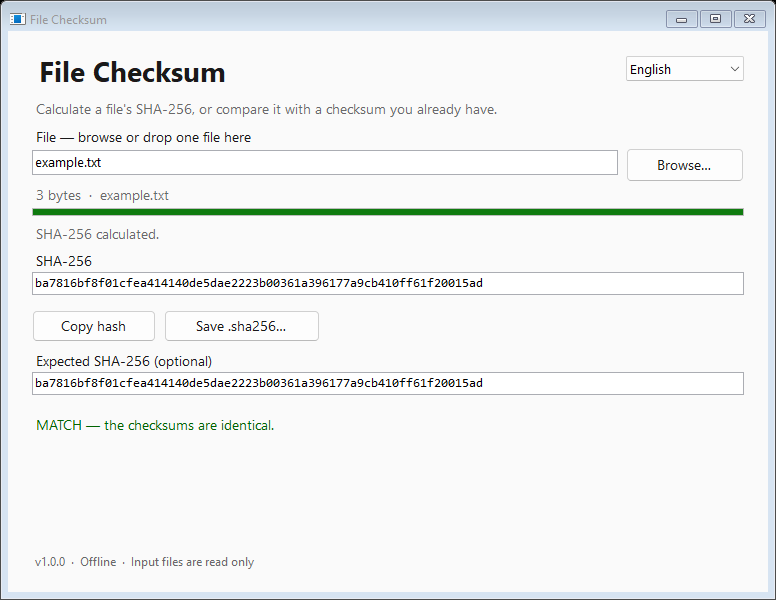

# File Checksum

A small Windows app for calculating a file's SHA-256 checksum and comparing it with an expected hash. Pick a file or drop it onto the window, then copy the result or save a `.sha256` file.

[Download for Windows](https://github.com/sixmillorcore-star/file-checksum/releases/latest) · [ภาษาไทย](docs/README.th.md)



*Rendered preview of the interface. See [validation notes](VALIDATION.md) for the checks performed and their limits.*

## Download and run

1. Download `FileChecksum-v1.0.0-windows.zip` from [Releases](https://github.com/sixmillorcore-star/file-checksum/releases/latest).
2. Extract the ZIP and open `FileChecksum.exe`.

Requires Windows 10 or 11 with .NET Framework 4.8. No installation, account, or API key is needed. The executable is unsigned, so Windows may show an unknown-publisher warning.

## Use

- **Calculate:** choose **Browse** or drag one file onto the window. Hashing starts automatically; progress and cancellation are available.
- **Compare:** paste an expected SHA-256 hash into the comparison field. It must contain exactly 64 hexadecimal characters. Uppercase and lowercase are accepted, and leading or trailing whitespace is ignored. Prefixes and spaces inside the hash are rejected.
- **Copy:** use the copy button to put the calculated hash on the clipboard.
- **Save:** choose a destination for a `.sha256` file. Its format is `hash`, two spaces, and the original file's base name, encoded as UTF-8 without a byte-order mark.
- **Language:** switch between English and Thai in the app. The choice lasts for the current session.

The app handles one file at a time. It reads the selected file without changing or deleting it. It makes no network requests and writes only the checksum file you choose to save. Clipboard access happens when you press copy.

A matching checksum means the file matches the expected hash. It does not establish who created the file or whether the file is safe to run. Obtain the expected hash from a source you trust.

## Build from source

On Windows with Windows PowerShell and .NET Framework 4.8:

```powershell
.\Build.ps1
.\tests\Run-Tests.ps1
.\tests\Run-UiTests.ps1
.\Package.ps1
```

The build uses the C# compiler supplied with Windows .NET Framework and creates `build/FileChecksum.exe`. Packaging creates `release/FileChecksum-v1.0.0-windows.zip` and `release/SHA256SUMS.txt`.

See [VALIDATION.md](VALIDATION.md) for validation results and [CHANGELOG.md](CHANGELOG.md) for changes.

## Report a problem

Open an [issue](https://github.com/sixmillorcore-star/file-checksum/issues) with your Windows version, steps to reproduce the problem, and any error message. Remove private file names, paths, and file contents before sharing logs or screenshots. Do not put sensitive security details in a public issue.

## License

[MIT](LICENSE). Copyright 2026 Sixmillor.
